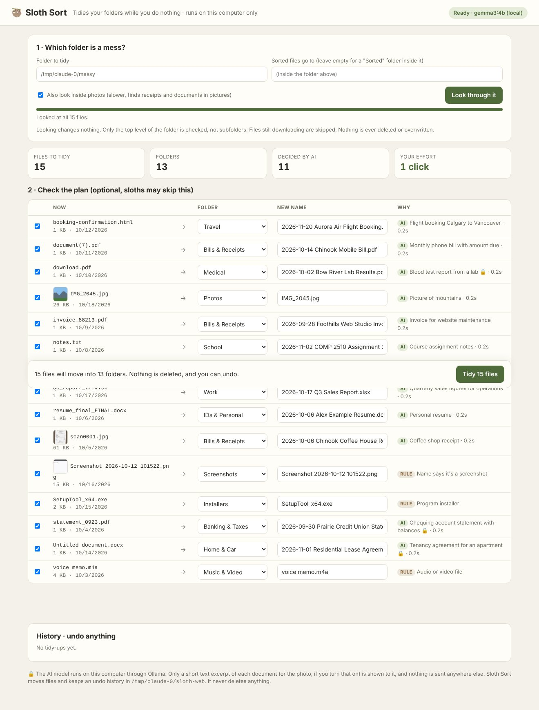
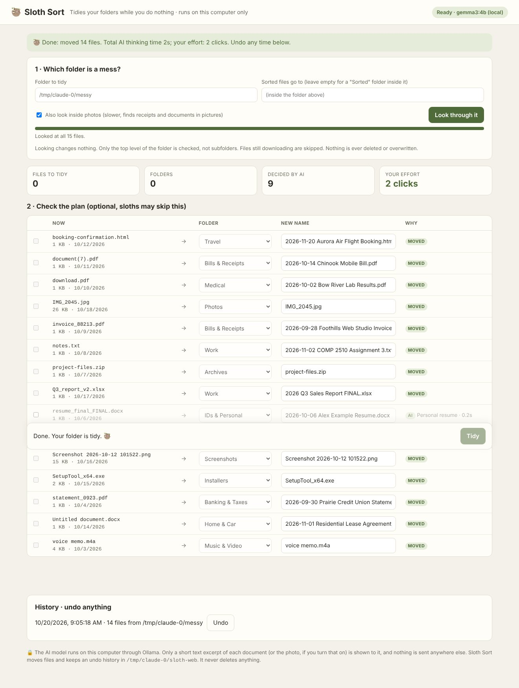

# Sloth Sort 🦥

[](https://github.com/GurminderKaur/SlothSort/actions/workflows/ci.yml)

**A local AI tidies your messy Downloads folder while you do nothing.**

`document(7).pdf` becomes `Bills & Receipts/2026-10-14 Chinook Mobile Bill.pdf`. `Untitled document.docx` becomes `Home & Car/2026-11-01 Residential Lease Agreement.docx`. Installers, zips and screenshots get filed too. It takes **two clicks**: *Look through it*, then *Tidy*.



- **Reads your files locally.** It pulls a short text excerpt from PDFs, Word, Excel, PowerPoint, text and HTML files (and, if you turn it on, looks at photos). A local open-weight model, **Gemma 3 4B via Ollama**, decides the folder, a human-friendly name and the document's date.
- **Rules first, AI second.** Installers, archives, audio/video and screenshots are sorted by rules instantly, with no AI needed.
- **Shows you the plan before anything moves.** Untick files, rename them or change their folder, or just click *Tidy*.
- **Never deletes, never overwrites.** Every change is a move, recorded in a journal, and **every tidy-up can be undone** with one click.
- **Stays private.** The page is served on `127.0.0.1` only. The model runs on your computer. Bank statements, IDs and medical letters never leave it, and Sloth Sort marks those files with 🔒.



## Set up on Windows (about 15 minutes, once)

**Easiest:** download `slothsort-win-x64.zip` from [Releases](https://github.com/GurminderKaur/SlothSort/releases), unzip it, and double-click `slothsort.exe`. (Windows SmartScreen may warn about an unsigned app: **More info → Run anyway**.)

You also need **Ollama** with the Gemma model:
```powershell
winget install -e --id Ollama.Ollama
ollama pull gemma3:4b        # ~3.3 GB, one time
```

**From source** (needs the .NET 8 SDK):
```powershell
git clone https://github.com/GurminderKaur/SlothSort.git
cd SlothSort\src\SlothSort
dotnet run -c Release
```
Your browser opens at **http://127.0.0.1:5179** with your Downloads folder filled in. Click **Look through it**.

## Command line (for the truly lazy)
```
slothsort plan <folder>          show what it would do (changes nothing)
slothsort tidy <folder> --yes    do it, with undo history (undo from the app)
slothsort selftest               run the built-in checks

--read-images    also look inside photos (finds receipts and documents in pictures; slower)
--dest <folder>  where sorted files go (default: <folder>/Sorted)
--model <name>   any Ollama model, e.g. gemma3:12b or qwen2.5vl:7b
```
`tidy` with Windows Task Scheduler (or cron) gives you a Downloads folder that tidies itself every night.

## Safety
- Only folders **inside your user folder** can be tidied from the app. Your whole user folder, AppData/Library/.ssh, and system or program folders are refused.
- Only the **top level** of the folder is touched; subfolders are left alone.
- Skipped: files still downloading (`.crdownload`, `.part`, …), files changed in the last 2 minutes, hidden and system files, Office lock files and shortcuts.
- Name clashes get `(2)`, `(3)`, never an overwrite. Undo checks that the original spot is still free before moving anything back.
- The local server only answers requests for `127.0.0.1` and needs a custom header for every change, so another website open in your browser can't trigger a tidy-up.

## How well does it sort?
On every push, [CI](.github/workflows/ci.yml) builds and self-tests on Windows, macOS and Linux. It then creates a messy folder of **fictional sample files** (`samples/make_messy_folder.py`) and has the real `gemma3:4b` plan the tidy-up. Each file is scored on "right folder?" and "sensible name?", and the results are posted in the run summary. The dry run is also checked to make sure it moved nothing.

## Why open models
- **Your files stay yours.** A Downloads folder is full of statements, IDs, leases and medical letters. A cloud API would need to see them; Gemma on your laptop doesn't send them anywhere.
- **Set it up once, never pay again.** There's no subscription or per-file fee, so tidying 2,000 files costs the same as tidying 20.
- **Works offline,** on a plane or with the Wi-Fi off.
- **Yours to change.** Swap the model, edit the folder list or the prompt, or add rules.

## Built with
[.NET 8](https://dotnet.microsoft.com) (ASP.NET Core minimal API) with **no third-party packages** (the PDF and Office text readers are built in), [Ollama](https://ollama.com), and [Gemma 3](https://ai.google.dev/gemma) (open weights, [Gemma Terms of Use](https://ai.google.dev/gemma/terms)).

**Limits:** scanned PDFs and PDFs with unusual font encodings yield no text, so Sloth Sort falls back to the file name. HEIC photos aren't read by the model. It suggests; you're always free to change the plan before tidying.

## Licence
MIT. See [LICENSE](LICENSE).
